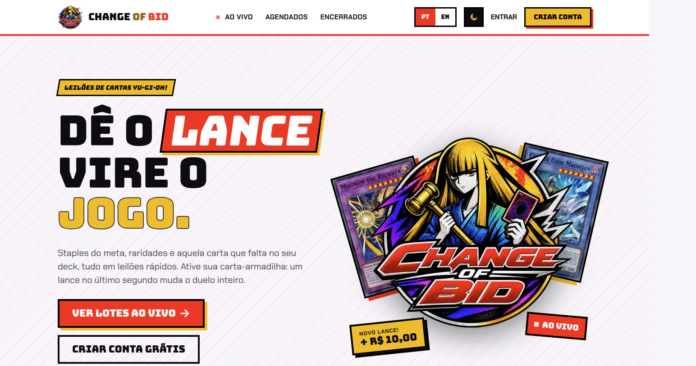

# Change of Bid

Frontend de um leilão de cartas de Yu-Gi-Oh. Feito para o desafio **Teste técnico: Elite Dev** na empresa Verzel.

A interface está em inglês e português do Brasil (padrão: português). Cadastro e login conversam com a API. As telas de lotes, lances, carteira e leiloeiro usam dados locais de exemplo.

A API fica em outro repositório: [change-of-bid-back](https://github.com/viicruz/change-of-bid-back).



## Nome e paleta

O nome foi inspirado na carta **Change of Heart**. A paleta foi pensada nas cores dessa carta e em cores que funcionam bem nos temas claro e escuro. O fundo é branco no tema claro e preto no tema escuro, porque prefiro telas com background nessas cores.

## Requisitos

- Node.js 20 ou mais recente
- npm
- O [backend](https://github.com/viicruz/change-of-bid-back) em execução para criar uma conta ou entrar

## Instalação e execução

```bash
npm install
cp example.env .env
npm run dev
```

Abra [http://localhost:3000](http://localhost:3000).

O `example.env` aponta o app para a API:

```bash
NEXT_PUBLIC_BACKEND_URL=http://localhost:3001
```

Altere esse valor se o backend não estiver na porta `3001`.

## Docker

O `docker-compose.yml` sobe só este frontend. PostgreSQL e a API ficam de fora: o [backend](https://github.com/viicruz/change-of-bid-back) precisa estar em execução antes.

Requisitos: Docker e Docker Compose. O compose usa a rede do host (`network_mode: host`), então `localhost:3001` aponta para a API tanto no navegador quanto dentro do container. Isso funciona no Linux.

```bash
cp example.env .env
docker compose up --build
```

Abra [http://localhost:3000](http://localhost:3000).

`NEXT_PUBLIC_BACKEND_URL` é lida do `.env` e fica fixada na imagem. O padrão é `http://localhost:3001`. Se mudar esse valor, suba de novo com `docker compose up --build`.

Para parar:

```bash
docker compose down
```

## Contas

O seed do [backend](https://github.com/viicruz/change-of-bid-back) (`npm run db:seed`) cria estas contas. A senha de todas é `123123123`.

Além das contas, o mesmo seed cadastra lotes, lances, recebimentos e a validação de hash por HMAC.

Esse seed já está em execução na [produção](https://change-of-bid-front.vercel.app/).


| E-mail                             | Papel                    |
| ---------------------------------- | ------------------------ |
| `bidder@bidder.bidder`             | Licitante (`BIDDER`)     |
| `bidder2@bidder.bidder`            | Licitante (`BIDDER`)     |
| `auctioneer@auctioneer.auctioneer` | Leiloeiro (`AUCTIONEER`) |


Build de produção:

```bash
npm run build
npm start
```

## Pesquisa de cartas

No painel do leiloeiro, a busca consulta o catálogo em inglês. Digite o nome da carta em inglês, mesmo com a interface em português.

Alguns nomes para testar:

- `Change of Heart`
- `Blue-Eyes White Dragon`
- `Dark Magician`
- `Red-Eyes Black Dragon`
- `Pot of Greed`
- `Mirror Force`

## Rotas


| Rota                  | O que faz                                                                                                                                                                                                           |
| --------------------- | ------------------------------------------------------------------------------------------------------------------------------------------------------------------------------------------------------------------- |
| `/`                   | Vitrine de lotes. Busca e filtra lotes por tipo de carta (monstro, magia, armadilha, extra deck) e status (ao vivo, agendado, cancelado, encerrado).                                                                |
| `/sign-up`            | Cria uma conta com nome, e-mail e senha.                                                                                                                                                                            |
| `/sign-in`            | Entra com e-mail e senha.                                                                                                                                                                                           |
| `/auction/[id]`       | Sala do lote. Mostra as cartas do lote, o lance atual e o histórico de lances. Um lote ao vivo também mostra o formulário de lance. Ids desconhecidos retornam 404. Exemplo: `/auction/lot-blue-eyes-white-dragon`. |
| `/auction/[id]/audit` | Auditoria pública de um lote: cartas e lances, com os nomes dos licitantes censurados. Ids desconhecidos retornam 404. Exemplo: `/auction/lot-blue-eyes-white-dragon/audit`.                                        |
| `/wallet`             | Saldo e histórico de transações.                                                                                                                                                                                    |
| `/my-bids`            | Lances do usuário autenticado.                                                                                                                                                                                      |
| `/auctioneer`         | Painel do leiloeiro para gerenciar lotes e as cartas dentro deles.                                                                                                                                                  |


